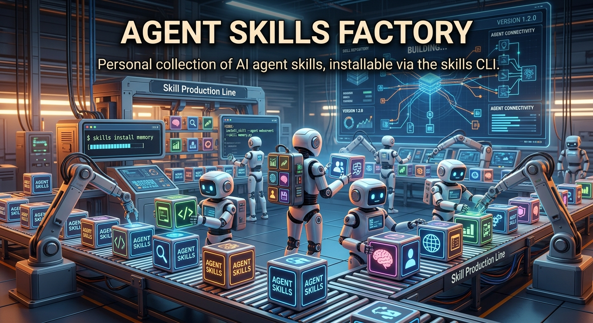

# Agent Skills Factory: Open-Source SKILL.md Skills for Claude Code, Codex & Cursor



[](#install)
[](#install)
[](./LICENSE)
[](https://github.com/AbdulDevHub/Agent-Skills-Factory/stargazers)

Reusable [Agent Skills](https://agentskills.io) (`SKILL.md` folders) that make AI coding agents better at everyday developer work: writing `AGENTS.md` context files, gitmoji + conventional commits, humanizing AI-written prose, web SEO, markdownlint cleanup and more. They work with Claude Code, OpenAI Codex, Cursor, GitHub Copilot, Gemini CLI and any other agent that reads the open `SKILL.md` format.

## Install

Any agent, through the [skills CLI](https://github.com/vercel-labs/skills) (pick the ones you want):

```bash
npx skills@latest add AbdulDevHub/Agent-Skills-Factory
```

One skill only:

```bash
npx skills@latest add AbdulDevHub/Agent-Skills-Factory --skill gitmoji-commit
```

Claude Code, as a plugin:

```text
/plugin install agent-skills-factory --marketplace AbdulDevHub/Agent-Skills-Factory
```

On Claude Code older than 2.1.275, add the marketplace first:

```text
/plugin marketplace add AbdulDevHub/Agent-Skills-Factory
/plugin install agent-skills-factory@agent-skills-factory
```

## Skills

| Skill | What it does |
| --- | --- |
| [`pick-my-brain`](./skills/pick-my-brain/SKILL.md) | Questions you before building. Full mode turns a rough idea into an approved build plan: homework first, term check, a "better, not bigger" ambition pass, approaches with trade-offs, then one-at-a-time grilling and a written plan. Quick mode settles the 1 to 3 unclear decisions in a mid-build change. Merged from grill-me, architect, be-ambitious and superpowers (all MIT, credited in the skill). |
| [`setup-agent-context`](./skills/setup-agent-context/SKILL.md) | Scaffolds or refreshes `AGENTS.md` plus a `context/` folder for new or existing codebases. |
| [`gitmoji-commit`](./skills/gitmoji-commit/SKILL.md) | Commits staged files with a gitmoji + conventional-commit message (`🐛 fix: ...`), splitting unrelated changes into separate commits. Never pushes. Can also rewrite a whole repo's old commit messages into the same style. |
| [`polish-push`](./skills/polish-push/SKILL.md) | End-of-day polish and publish for a repo: secret scan, verify, SEO check, README and screenshot refresh, GitHub metadata, agent context update, gitmoji commit and push. |
| [`humanizer`](./skills/humanizer/SKILL.md) | Removes AI writing patterns from prose while keeping the writer's voice, or flags them without rewriting. Merged from three MIT projects (credited in the skill). |
| [`web-seo-optimization`](./skills/web-seo-optimization/SKILL.md) | SEO and social-sharing setup for React, Vite, Next.js and static sites: meta tags, Open Graph, JSON-LD, PWA manifest, sitemap, robots.txt. |
| [`omni-ui`](./skills/omni-ui/SKILL.md) | Designs, builds, polishes, critiques and audits web UI: token plan first, an AI-slop ban list, accessibility checklist, motion and consistency guides. Merged from several open-source design skills (Anthropic and impeccable under Apache 2.0; ui-ux-pro-max, imprint, taste-skill and others under MIT; credited in `SOURCES.md`) and written as a reference rather than hard rules, with steps to pull upstream updates. |
| [`markdownlint-fix`](./skills/markdownlint-fix/SKILL.md) | Fixes or suppresses markdownlint warnings across a project and configures rule exceptions. |
| [`free-helpers`](./skills/free-helpers/SKILL.md) | Offloads bulky or parallel jobs to free models (Gemini, OpenRouter, Groq, Cerebras via a local hub, Copilot CLI) when Claude usage is tight. |
| [`upgrade`](./skills/upgrade/SKILL.md) | Self-improvement loop for a Claude Code setup: reviews a conversation for things worth saving and applies queued upgrades. |

## Keeping third-party skills in sync without losing edits

This repo is also my live `~/.agents` folder, so it manages skills I didn't write. The interesting part is the tooling around that:

- **Edits are detected automatically.** A Claude Code session hook (kept outside this repo at `~/.claude/hooks/sync-skills.ps1`) fingerprints each external skill at install time (`.skill-baseline.json`). If its content later changes without an upstream update, the skill counts as modified: it's un-ignored and committed.
- **Updates three-way merge.** [`scripts/update-skills.ps1`](./scripts/update-skills.ps1) runs `npx skills update`, then merges upstream changes into each locally edited skill with `git merge-file` (old upstream as the base, fetched by its locked tree hash). Clean merges are committed; conflicts are left as `<<<<<<<` markers.
- **Everything is pinned.** Unmodified external skills are gitignored and recorded in `.skill-lock.json`, so `npx skills experimental_install` restores the exact set, like `npm ci`.

Modified external skills kept in git under their original licenses:

| Skill | Source | License | What I changed |
| --- | --- | --- | --- |
| `grill-me` | [mattpocock/skills](https://github.com/mattpocock/skills) | MIT | Self-contained interview instructions and a description that triggers on "grill me", "stress-test this", etc. |

The unmodified ones (design systems, code review, diagramming, backend SDKs) are listed with sources in [External Skills.md](./External%20Skills.md).

```powershell
powershell -ExecutionPolicy Bypass -File ~/.agents/scripts/update-skills.ps1
```

The former `archive/` folder (an August 2026 snapshot of every skill) lives in git history: `git checkout 84d2200 -- archive`.

## Contributing

Issues and PRs are welcome, especially bug reports from running a skill in an agent other than Claude Code. Each skill is a folder at `skills/<name>/SKILL.md` with YAML frontmatter (`name`, `description`); quote any description that contains a colon.

## License

My skills and scripts are [MIT](./LICENSE). Skills adapted from other projects keep their original licenses (see the source links above).

Built by [Abdul Khan](https://github.com/AbdulDevHub).
