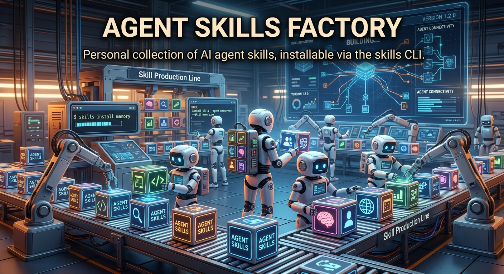

# Agent Skills Factory



Personal collection of AI agent skills, installable via the skills CLI.

## My skills

- **`context-bootstrap`**: scaffolds a new project's foundational AI-context docs in one pass: `AGENTS.md`, architecture overview, build plan, code standards, library docs, progress tracker, project overview, and UI registry/rules/tokens references.
- **`context7-mcp`**: tells an agent when and how to pull current library/API docs from the Context7 MCP server instead of relying on stale training data.
- **`footer-note-comments`**: writes algorithm/interview-style code (LeetCode, HackerRank, etc.) with a numbered "footer notes" block instead of inline comments, so the code stays clean but non-obvious reasoning is still documented.
- **`free-helpers`**: hands bulky or parallel jobs to free models (Gemini, OpenRouter, Groq, Cerebras and others via a local FreeLLMAPI hub, Copilot CLI, or an Antigravity handoff) when Claude usage is tight or another model is better at the task.
- **`git-reformat-history-agent`**: rewrites an entire repo's commit history into conventional-commits + gitmoji style, executed directly by an agent with terminal/git access.
- **`gitmoji-commit`**: commits staged files with a gitmoji + conventional-commit message, splitting unrelated changes into separate commits when it helps. Never pushes.
- **`humanizer`**: removes AI writing patterns from prose while keeping the writer's voice, or flags them without rewriting (detect mode). Merged from blader/humanizer, petergyang/no-ai-slop and hardikpandya/stop-slop (all MIT).
- **`js-style-refactor`**: refactors or reviews JavaScript into my personal style: flat single-file layout, one `state` object, cached `elements`, feature-namespaced objects, no semicolons.
- **`markdownlint-fix`**: fixes or suppresses markdownlint warnings across a project, including configuring `.vscode/settings.json` and rule exceptions for cases that shouldn't be auto-fixed.
- **`setup-agent-context`**: scaffolds or refreshes `AGENTS.md` plus a `context/` folder (progress tracker, architecture, build plan, code standards, UI rules) for new or existing projects.
- **`upgrade`**: self-improvement loop for my Claude setup. Applies items from the Upgrades inbox, or reviews the current conversation for things worth saving.
- **`web-seo-optimization`**: SEO and social-sharing readiness for web apps: meta tags, Open Graph/Twitter cards, JSON-LD, PWA manifest, sitemap, robots.txt, semantic HTML.

## Modified external skills

These come from other people's repos, but I've edited them, so they're kept in git here (with their original license) instead of being restored from the lock file:

| Skill | Source | License | What I changed |
| --- | --- | --- | --- |
| `git-commit` | [github/awesome-copilot](https://github.com/github/awesome-copilot) | MIT | Adds gitmoji to the conventional-commit format. |
| `grill-me` | [mattpocock/skills](https://github.com/mattpocock/skills) | MIT | Self-contained interview instructions and a description that triggers on "grill me", "stress-test this", etc. |
| `skill-creator` | [anthropics/skills](https://github.com/anthropics/skills) | Apache 2.0 (`LICENSE.txt`) | Test cases as per-case folders under `evals/`, matching the `claude plugin eval` layout. |

## Unmodified external skills

Everything else (design systems, code review, diagramming, backend SDKs, etc.) is sourced from other people's repos and deliberately not vendored here. They're gitignored and pinned in `.skill-lock.json`. See `External Skills.md` for the list with links to their sources.

## How skills stay safe

- **Edits get saved automatically.** A sync hook (`~/.claude/hooks/sync-skills.ps1`) records a fingerprint of each external skill when it's installed (`.skill-baseline.json`). If the content later changes without an upstream update, that skill counts as modified: it's taken out of `.gitignore` and committed. The hook runs at the start and end of every Claude Code session, and the update script runs it first too. The one gap: editing an external skill and then running a bare `npx skills update` before the hook has run.
- **Updating:** run `scripts/update-skills.ps1` instead of a bare `npx skills update`. It runs the update, then three-way merges upstream's changes into each modified skill (old upstream, your version, new upstream) and commits if everything merged cleanly. If both sides changed the same lines, it leaves `<<<<<<< mine` / `>>>>>>> upstream` markers for you to resolve. If you run `npx skills update` directly by mistake, the hook holds back the overwritten skill and the script can still merge it.
- **Old snapshots:** the former `archive/` folder (an August 2026 copy of every skill) was removed. It's still in git history: `git checkout 84d2200 -- archive`.

```powershell
powershell -ExecutionPolicy Bypass -File ~/.agents/scripts/update-skills.ps1
```

## Install

Pick and choose:

```bash
npx skills@latest add AbdulDevHub/Agent-Skills-Factory
```

Restore my exact external skill set (after cloning this repo, uses `.skill-lock.json`):

```bash
npx skills experimental_install
```
